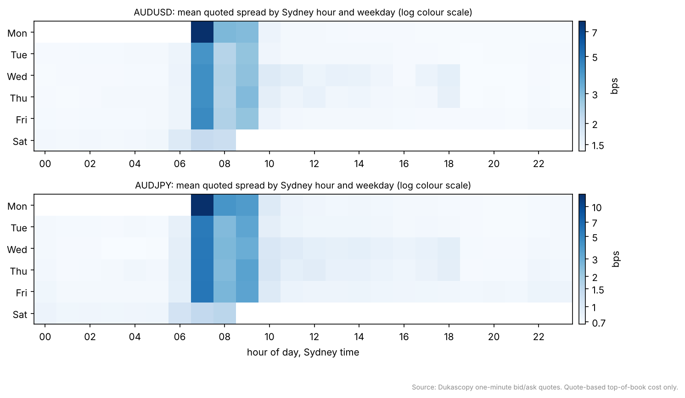
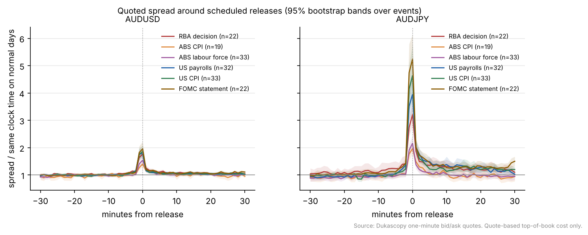
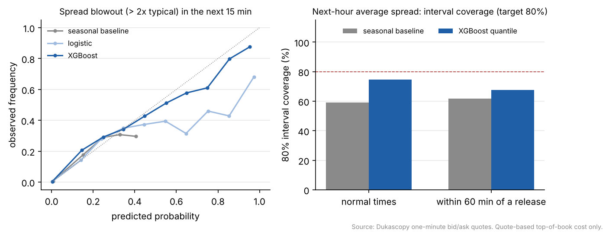
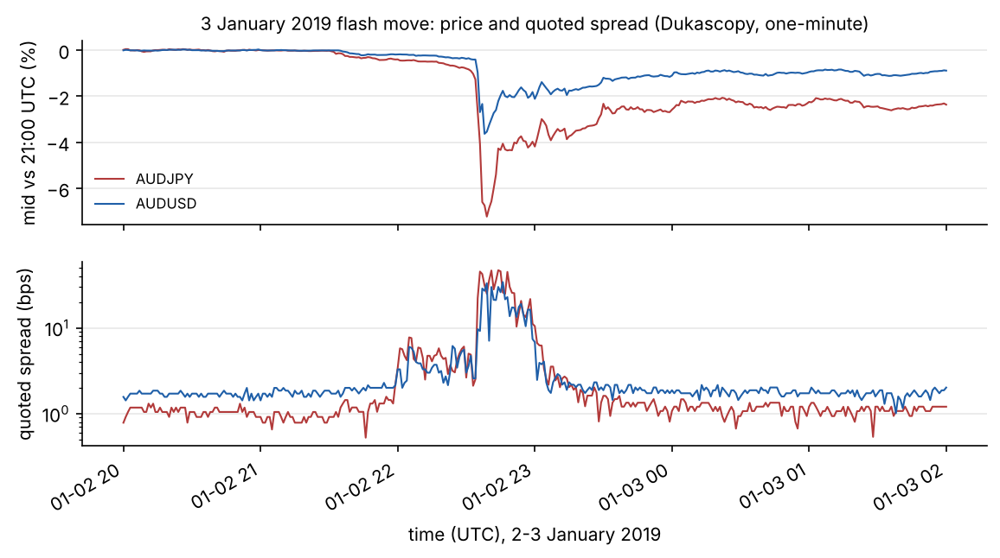

# AUD Cost Atlas

**When is it cheapest and most expensive to trade AUDUSD and AUDJPY, how much do scheduled releases change that, and can you forecast it?**


> **What this measures.** FX is over the counter: there are no trade prints, and quoted volumes are indicative. This study measures **quote-based cost at the top of one venue's book** (Dukascopy), which is what a small to mid-sized order pays. It **cannot estimate market impact for large orders**, and nothing below should be read as the cost of a $50M ticket.

## Key findings

Data: Dukascopy one-minute bid and ask quotes for AUDUSD, AUDJPY and EURUSD (as a control), 1 January 2024 to 26 October 2026, about 1.05 million trading minutes per pair, plus January 2019 for a case study. The event calendar has 172 releases, each with an official source URL.

1. **Inside liquid hours, the clock barely matters; outside them, it matters a lot.** AUDUSD's median quoted spread is **1.42 bps**. Across the London, New York and Tokyo sessions the mean moves only between **1.37 and 1.50 bps**. The 17:00 New York rollover costs **7.1 bps** on average (about 5x), and the Monday open is the worst hour of the week at **8.1 bps**. AUDJPY's rollover spread is about **15x** its London level (10.9 against 0.70 bps).
2. **Scheduled releases roughly double AUDUSD's spread for a minute, and do far more to AUDJPY.** In the release minute AUDUSD's spread is **1.4x** normal for ABS CPI, **1.5x** for the ABS labour force survey, **1.8x** for the RBA decision and US payrolls, **1.9x** for US CPI and **2.0x** for FOMC statements. AUDJPY widens **2.0x to 5.2x** at the same releases and stays elevated for longer after US data. All twelve AUD-pair effects survive Holm correction across pairs and event types.
3. **The control pair behaves as it should.** EURUSD shows no effect from Australian releases (RBA **1.13x**, ABS **0.9x**, Holm-adjusted p of 0.16 or more) while widening **2.8x to 4.3x** around US payrolls, CPI and FOMC. The event study is picking up information, not a clock artefact.
4. **Forecasting helps, but its intervals are too narrow.** Walk-forward over 31 months, an XGBoost quantile model cuts pinball loss for the next hour's average spread by **45%** in normal times and **51%** within an hour of a release, against a seasonal median. Its 80% intervals cover **75%** of outcomes in normal times and **68%** near releases (the seasonal baseline: 59% and 62%). For the 2% of 15-minute windows with a spread blowout (above twice the typical level), the Brier score near releases falls from **0.132** (seasonal) to **0.115** (logistic) and **0.089** (XGBoost).
5. **Liquidity regimes are stable.** A Gaussian mixture on 15-minute windows finds calm, active and stressed regimes (about **90%**, **4%** and **6%** of windows). A model fitted on the first half of the sample labels the second half almost exactly as a model fitted on the second half itself does (adjusted Rand index **0.97**).
6. **Case study, 3 January 2019.** In thin liquidity just after 9:30am Sydney time, AUDJPY fell **7.2%** in under two hours to its low at 22:39 UTC, and its quoted spread peaked at **47 bps** against about **2.3 bps** at that minute on normal days. AUDUSD fell **3.6%** with a spread peak of **34 bps**. By 02:00 UTC both had recovered about 70% of the fall. This is exactly the window a cost model built on averages would get badly wrong.

## Charts






## Execution advisor

```bash
python -m atlas.advisor --pair AUDUSD --notional 5e6 --urgency 2 --start 2026-11-02
```

It ranks two-hour windows over the next two weeks by the expected half-spread cost of a taker-only slicing schedule (resampling historical spreads for each weekday and Sydney hour) and flags windows within 30 minutes of a scheduled release. For $5M over two hours from Monday 2 November 2026, the cheapest windows start at **7pm or 8pm Sydney time** (the London morning), at about **0.69 bps**, or roughly **$340**. The dearest event-free windows start at **7am Sydney**, the New York rollover, at about **2.8 bps**, or roughly **$1,380**. It flags the RBA decision (Tuesday 3 November, 2:30pm), US payrolls (Saturday 7 November, 12:30am Sydney) and US CPI (Wednesday 11 November, 12:30am Sydney), and reminds the user that size impact is not modelled.

## Method

Quotes are cleaned (non-positive, crossed and outlier quotes dropped; anything outside the Sunday 17:00 to Friday 17:00 New York trading week removed; gaps flagged), and every minute gets its quoted spread from the bar's opening and closing bid and ask. **Sessions** are defined by local clock time in Sydney, Tokyo, London and New York, never by fixed UTC hours, because the three daylight-saving regimes move the overlaps through the year; the rollover is its own bucket. The **event study** divides each release's spread path by the mean path at the same clock minutes on non-release days with the same weekday (within eight weeks), so the time-of-day pattern cancels; bands resample events, and p-values are Holm-adjusted across pairs and event types. **Forecasts** run every 15 minutes, walk-forward by calendar month, with features that use only the past and the published release schedule. Bootstrap, splits and multiple-testing control come from [Skeptic](https://github.com/OWNER/skeptic).

## Pipeline validation on planted effects

The same code was run on a synthetic quote stream with known, planted effects (`make validate`, results in [`reports/synthetic`](reports/synthetic)). It recovers all six planted event multipliers within their 95% bands: RBA 2.97x (planted 3.0), US payrolls 2.60x (2.5), US CPI 2.08x (2.0), FOMC 2.13x (2.0), ABS CPI 1.94x (1.8) and ABS labour force 1.82x (1.8). It finds no effect where none was planted (EURUSD on Australian releases, Holm p = 1.0), and correctly finds no stable regimes in data that has none (adjusted Rand index 0.15).

## Event calendar

[`data/calendar/events.csv`](data/calendar/events.csv): 172 rows, each with an official source URL. The loader refuses any row without one from rba.gov.au, abs.gov.au, federalreserve.gov or bls.gov.

| Event | Released (Jan 2024 to Oct 2026) | Release time | Source |
|---|---|---|---|
| RBA cash rate decision | 22 (+2 scheduled) | 2:30pm Sydney | RBA media releases |
| ABS Labour Force | 33 (+1 scheduled) | 11:30am Sydney | ABS release pages |
| ABS CPI (quarterly to Sep 2025, then monthly) | 20 (+1 scheduled) | 11:30am Sydney | ABS release pages |
| US Employment Situation | 32 (+2 scheduled) | 8:30am New York | BLS release archive |
| US CPI | 33 (+2 scheduled) | 8:30am New York | BLS release archive |
| FOMC statement | 23 (+1 scheduled) | 2:00pm New York | Federal Reserve calendar |

The October 2025 US payrolls and CPI releases were never published, because of the lapse in federal appropriations, and are absent. The ABS monthly CPI indicator that ran alongside the quarterly CPI until 2025 is not included.

## What failed or is missing

- **Interval calibration.** Both the seasonal baseline and XGBoost under-cover; near releases the XGBoost intervals cover 68% instead of 80%. Conformal recalibration on recent residuals is the next step.
- **Within-minute detail.** One-minute bars carry two quote snapshots per minute, so spikes between them are invisible and blowout rates are lower bounds. The tick loaders (`--source bi5` or `--source histdata`) are written and tested, but the tick history was not available in the build environment.
- **Stretch goals not built:** the isolation-forest anomaly detector and the central-bank tone features.

## Limitations

- **Quote-based only:** no trade prints, no depth, no size impact.
- **One venue.** Dukascopy is a single liquidity source; bank and ECN pricing differ, and a venue's spread can be partly a fixed markup, which would explain why AUDUSD's spread varies so little within liquid hours.
- **Small samples per event type:** 19 to 33 releases each, so intervals are wide and the event count is always shown.

## Reproduce

| Command | What it does |
|---|---|
| `make data` | fetch the Dukascopy one-minute bid/ask files used here (about 100 MB, from a public GitHub mirror) |
| `make test` | 21 tests, including session boundaries across every daylight-saving transition, the calendar's source check, the HistData time-zone convention, the bid/ask bar loader and a no-lookahead check on the forecast features |
| `make reproduce` | the checked-in six-month AUDUSD sample (real data), about 2 minutes |
| `make full` | the study behind this README, about 25 minutes |
| `make validate` | the planted-effect validation run |
| `make advisor` | the advisor example above |

## Notes

- [When is AUDUSD cheapest to trade? A quote-based study (2-page note, PDF)](docs/note.pdf)
- [Crypto versus FX: what transfers from ExecLab and what does not](docs/crypto_vs_fx.md)

## What I would do with internal data

Public quotes only show the cost of crossing a small amount at the top of one book. With a desk's own data I would (1) measure realised slippage by size from fills against arrival mid, adding the size dimension this study lacks; (2) use RFQ logs to see how dealer pricing widens with size and around releases, and whether this heatmap predicts it; (3) model how often client flow nets out internally, turning "when is the market cheap" into "when should we hedge rather than wait"; and (4) estimate last-look reject rates, the FX analogue of ExecLab's fill models. Each would go through the same walk-forward, bootstrap and multiple-testing protocol. More detail: [docs/internal_data.md](docs/internal_data.md).

## Data source

One-minute bid and ask bars are Dukascopy data, fetched from the public [tradesensedev/dukascopy-data](https://github.com/tradesensedev/dukascopy-data) mirror. Check Dukascopy's terms of use before redistributing; the repository ships only a six-month sample for CI.
