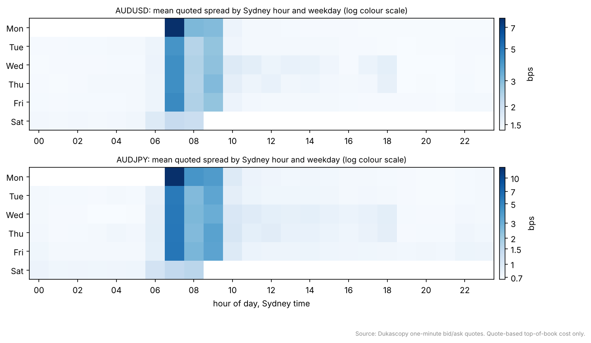
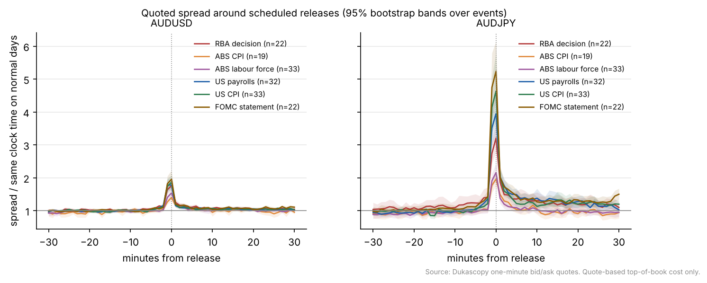

# When is AUDUSD cheapest to trade? A quote-based study

*Athish Shubhan, October 2026. Two-page note accompanying the AUD Cost Atlas.*

## Question and scope

A desk that must buy or sell Australian dollars often has some freedom over *when*. This note asks how the cost of crossing the spread in AUDUSD (with AUDJPY, and EURUSD as a control) varies by hour, weekday and session, how much scheduled releases add, and whether it can be forecast. FX is over the counter, so public data has no trade prints and only indicative sizes. Everything here is **quote-based top-of-book cost** from one venue (Dukascopy one-minute bid and ask bars, January 2024 to October 2026), which is what a small to mid-sized order pays. It says nothing about the market impact of a large order.

## Method in brief

Quotes are cleaned and each minute's spread is the average of its opening and closing quoted spread. Sessions are defined in local clock time in Sydney, Tokyo, London and New York, because Australia and the northern hemisphere change clocks in opposite seasons: the London/New York overlap runs from midnight to 4am Sydney time in January and from 10pm to 2am in July. The event study divides each release's spread path by the same clock minutes on comparable non-release days, so a ratio of 1 means "a normal day at this time", using a calendar of 172 releases with official sources. Forecasts are walk-forward by month. The code first had to recover known effects planted in synthetic data, which it did for all six event types.

## Results

**Time of day matters less than you might expect, except at two moments.** AUDUSD's median spread is 1.42 bps, and across the London, New York and Tokyo sessions its mean moves only between 1.37 and 1.50 bps. The cheapest hours are the London morning (7pm to 9pm Sydney). Two moments are expensive: the 17:00 New York rollover, at 7.1 bps on average, about five times normal, and the Monday open in Sydney, at 8.1 bps. AUDJPY is more extreme, with a rollover spread about fifteen times its London level.

**Releases briefly double the AUDUSD spread, and do much more to AUDJPY.** In the release minute AUDUSD's spread is 1.4 times normal for ABS CPI, 1.5 times for the labour force survey, 1.8 times for the RBA decision and US payrolls, 1.9 times for US CPI and 2.0 times for FOMC statements. The effect is mostly gone within two minutes. AUDJPY widens 2.0 to 5.2 times and stays elevated for longer after US data. EURUSD, the control, does not react to Australian releases but widens 2.8 to 4.3 times for US ones, which suggests the method is measuring information arriving rather than a clock artefact.

For a desk, the practical rule is simple: avoid the rollover and the Monday open, and keep a few minutes clear of the release time of anything on the calendar, especially for AUDJPY. An execution advisor built on these results puts a $5M two-hour AUDUSD order at about 0.69 bps (roughly $340) of half-spread in the London morning and about 2.8 bps (roughly $1,380) starting at the rollover, and flags the RBA, payrolls and CPI releases in the window.

**Forecasting.** An XGBoost quantile model roughly halves pinball loss for the next hour's average spread against a seasonal median, both in normal times (45%) and near releases (51%). Its 80% intervals are too narrow, covering 75% of outcomes in normal times and 68% near releases, so they would need recalibrating before use. Blowouts above twice the typical spread happen in 2% of 15-minute windows; near releases, the classifier's Brier score is 0.089 against 0.132 for the seasonal baseline. Liquidity regimes from a Gaussian mixture are stable from one half of the sample to the other (adjusted Rand index 0.97): about 90% calm, 4% active and 6% stressed.

**Why averages are not enough.** On 3 January 2019, shortly after 9:30am Sydney time in thin liquidity, AUDJPY fell 7.2% and its quoted spread reached 47 bps, about twenty times normal for that minute; AUDUSD fell 3.6% with a 34 bps spread. A cost model built on hourly averages would have priced that minute at a couple of basis points.

## Limits, and what internal data would add

One venue, one-minute snapshots and quote-based costs are the main limits; the venue's spread may be partly a fixed markup, which would flatten the time-of-day pattern. A desk's own data would add what public quotes cannot: realised slippage by size from its fills, RFQ spreads around releases, last-look reject rates, and how often client flow nets out before it needs hedging.
